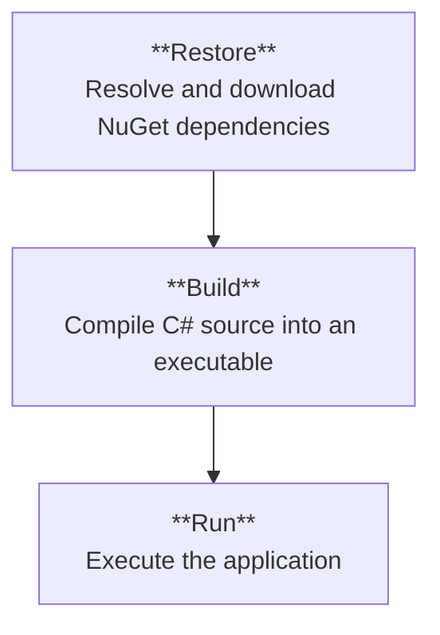

## Execute via command line
```
dotnet run 
```

Use this via powershell (Windows). On Linux a normal terminal will do. You need to be in the directory where your `*.csproj` file is located. 

In case there is an error: 
```
dotnet restore
```
Downloads and prepares the external dependencies (libraries) that your C# project needs to compile and run.
**However, you normally shouldn't need to execute** `dotnet restore` **manually when using Visual Studio (see below).** Visual Studio is designed to restore missing dependencies automatically.

When you execute `dotnet restore` .NET performs several operations:
1. Reads the `.csproj` file to identify dependencies.
2. Resolves the required NuGet packages and their dependencies.
3. Downloads missing packages from the configured NuGet sources (usually nuget.org).
4. Stores downloaded packages in a local cache, typically `%USERPROFILE%\.nuget\packages`.
5. Generates dependency information in the folder `obj/project.assets.json`, which the compiler subsequently uses.   

Restore **does not compile or execute your application**. It prepares the dependencies for compilation.


## Typical project structure
```
NfcCli/
├── NfcCli.csproj
├── Program.cs
├── MyClass1.cs
├── 📄 README.md
├── 📁 bin
├── 📁 obj
└── 📁 .vs
```

#### What is the purpose of  `bin`, `.vs` and `obj`?
These folders are auto-generated when building/compiling the code. Typically you will not need to change the contents of these folders.

> [!warning]
> **Version control (git):** Make sure `bin/`, `obj/`, and `.vs/` are listed in your `.gitignore` file so you don't bloat your repository or cause merge conflicts with other developers' local settings.

`bin` = "binary" -> final output 
Compiled `.dll` / `.exe` files, `.pdb` debug symbols, config files, and copied dependencies—organized by configuration (`Debug` / `Release`) and target framework (e.g., `net8.0`).
=> Holds the runnable application or library that you actually execute or deploy.

`obj` = "object" -> Intermediate files
Temporary build artifacts, NuGet restore data (`project.assets.json`), and auto-generated code (like `AssemblyInfo.cs` or XAML/Razor generated files).
=> Speeds up **incremental builds** so the compiler only rebuilds files that changed instead of starting from scratch.

`.vs` = "Visual Studio" -> *hidden* folder
User-specific settings, open tabs, breakpoints, window layouts, and IntelliSense/search caches

> [!info]
>**Fixing weird build errors:** If Visual Studio shows phantom errors or stale NuGet references, closing the IDE and manually deleting `bin` and `obj` (then rebuilding) often resolves them.


## Using Visual Studio *Code*
Visual Studio Code is lightweight and quite capable for simple programming tasks. You need to install the .NET runtime before being able to execute C# code. For convenience I also recommend installing the C# Dev Kit via the plugin manager.

## Using Visual Studio
When pressing `F5` or you click the green arrow in the menu, Visual Studio triggers the following pipeline:



