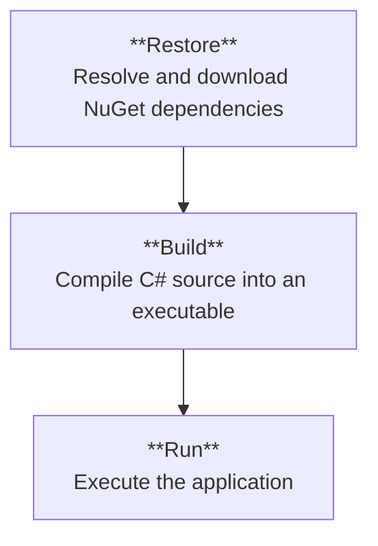

## Execute via command line
```
dotnet run 
```

Use this via powershell (Windows). On Linux a normal terminal will do. You need to be in the directory where your `*.csproj` file is located. 

In case there is an error: 
```
dotnet restore
```
Downloads and prepares the external dependencies (libraries) that your C# project needs to compile and run.
**However, you normally shouldn't need to execute** `dotnet restore` **manually when using Visual Studio.** Visual Studio is designed to restore missing dependencies automatically.

When you execute `dotnet restore` .NET performs several operations:
1. Reads the `.csproj` file to identify dependencies.
2. Resolves the required NuGet packages and their dependencies.
3. Downloads missing packages from the configured NuGet sources (usually nuget.org).
4. Stores downloaded packages in a local cache, typically `%USERPROFILE%\.nuget\packages`.
5. Generates dependency information in the folder `obj/project.assets.json`, which the compiler subsequently uses.   

Restore **does not compile or execute your application**. It prepares the dependencies for compilation.


## Typical project structure
```
NfcCli/
├── NfcCli.csproj
├── Program.cs
├── MyClass1.cs
└── README.md
```

## Using Visual Studio *Code*
Visual Studio Code is lightweight and quite capable for simple programming tasks. 

## Using Visual Studio
When pressing `F5` or you click the green arrow in the menu, Visual Studio triggers the following pipeline:



